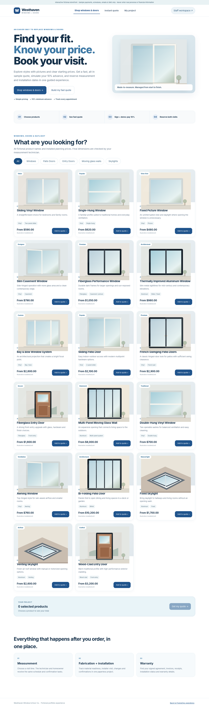
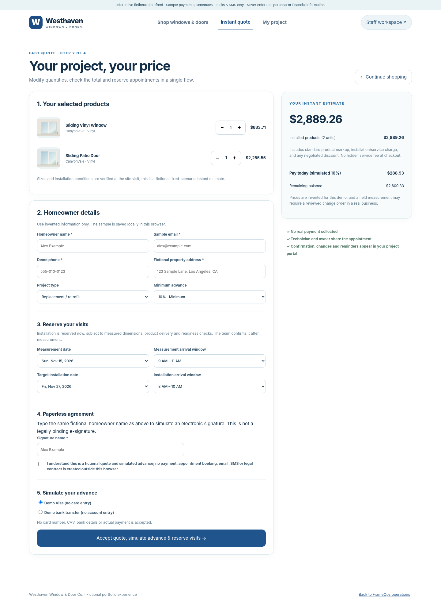
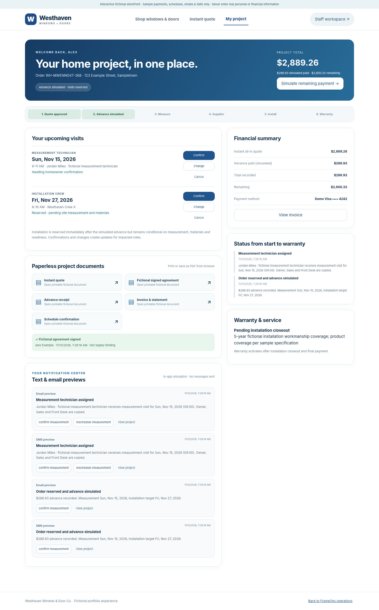
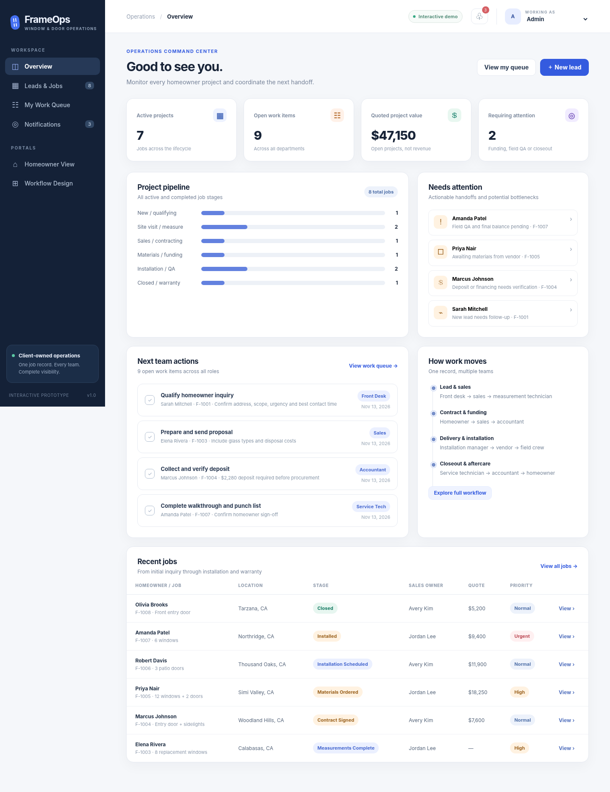
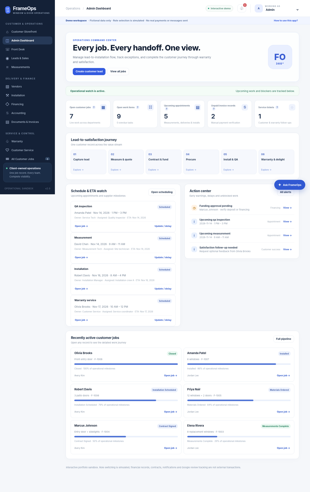
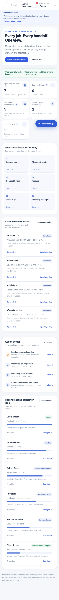
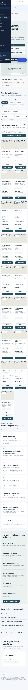
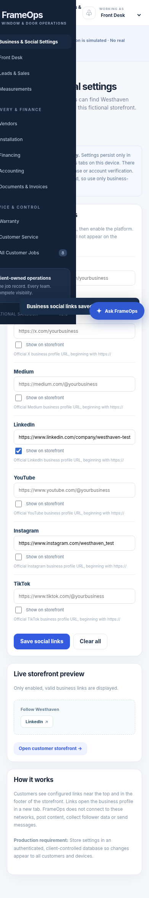
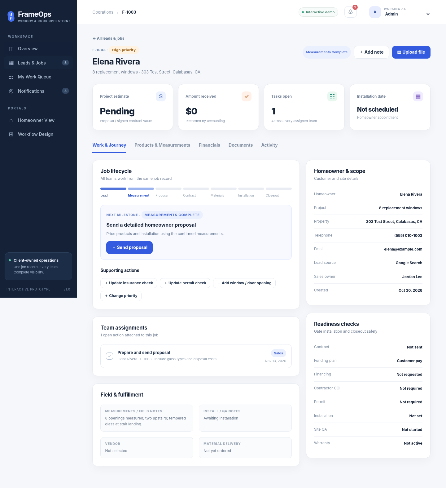
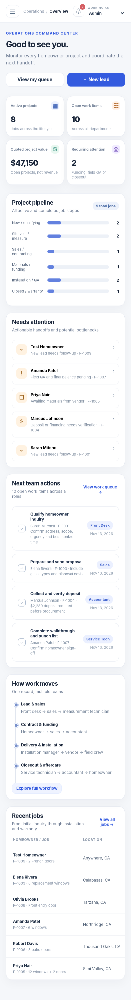

# FrameOps — Window & Door Operations

**A customer-first window and door storefront connected to a fictional cross-functional operations command center.**

**[Explore the live FrameOps application](https://frameops-operations.onrender.com/)** · [Source repository](https://github.com/sachintechpro/frameops-window-door-operations)

FrameOps illustrates how one end-to-end value stream can replace disconnected spreadsheets, phone calls, and handoffs with a shared homeowner/job record, visible dependencies, and accountable work queues.

> **Interactive portfolio demo, not a production customer system.** All included homeowners, addresses, suppliers, and financial records are fictional. Anyone using the public demo must enter fictional data only. Role switching demonstrates journeys and **does not provide authentication or enforce real access control**.

## FrameOps 2.4 — Fast quote → advance → immediate booking → paperless portal

**The public app now opens directly to Westhaven's consumer storefront.** Homeowners choose fictional windows, patio doors, entry doors and skylights from illustrated product cards, see a calculated **instant all-in sample quote**, type a demo agreement acknowledgement, simulate paying **at least 10% advance**, and reserve measurement and installation dates in one checkout. Installation is reserved immediately, but **conditional on verified measurements and product/crew readiness**, not falsely guaranteed.

Customer follow-through is contained in the redesigned **Customer Project Portal**: order summary, receipts, sample invoice, fictional signed agreement and schedule confirmation, simulated payment method, outstanding balance/pay button, confirmation/rescheduling/cancellation controls, job timeline and closeout warranty. Printable documents can be saved to PDF using the browser. Simulated email and SMS previews include actionable buttons for confirmation, rescheduling and payments. **No actual messages are delivered and no funds move.**

The staff-side **Quote & Schedule Console** contains a product cost calculator, negotiated sales discounts (0–5%), minimum-margin enforcement, measurement technician assignment, the owner/field role inboxes, supplier delays, installation readiness and simulated 24-hour/1-hour appointment reminders. Reminders are evaluated while a demo browser is open or through demo-clock controls; they do **not** run as a background messaging service.

**Internal price rule:** fictional supplier cost × 1.45 standard product markup × 1.10 service charge; sales may negotiate up to 5% discount but the final price can never fall below **supplier cost × 1.35 × 1.10**. The 10% minimum advance is applied to the **final quote**. Supplier cost and margin details are shown only in the simulated staff view, which **is not authenticated**.

All quote, payment, signature, scheduling, social and message state is in browser `localStorage`; `BroadcastChannel` can synchronize tabs on the same origin/browser. **No cross-device or cross-user synchronization**, verified identity, legally valid e-signature, real card processing, calendar booking, persistent shared documents or true email/SMS delivery exists. Never enter real contact or payment information.









## FrameOps 2.0 — operations command center

A coordinated dashboard now organizes these customer and departmental workspaces: **Customer Storefront, Admin Dashboard, Front Desk, Leads & Sales, Measurements, Vendors, Installation, Financing, Accounting, Warranty, Customer Service, Documents & Invoices**, plus the shared **Jobs, Work Queue, Notifications and Value Stream** views.

Features include scheduled appointments, calendar dates, supplier ETAs and delay reasons, priority banners, contextual tooltips, a deterministic **Ask FrameOps** operating guide, printable sample invoices, customer service tickets with response targets, customer satisfaction records, and optional Google review-invitation status. Google reviews are customer-authored and remain on Google's own platform; this app does not post or verify them.





The new [Operating Guide](OPERATING_GUIDE.md) walks through all modules and the [Production Readiness Checklist](PRODUCTION_READINESS.md) documents the essential security, integrations and operations requirements for real customer use.

## FrameOps 2.3 — Consumer storefront and browser-only experience

The **Westhaven Window & Door Co.** customer storefront uses a wholly fictional catalog inspired by the product/service structures of window and door installers and suppliers. The 17 original sample listings cover vinyl, fiberglass, aluminum, wood-clad, sliding, hung, casement, awning, picture, bay/bow, entry, patio, folding-door, moving-glass and skylight products. **CanyonVale, SolaraForm, AeroLoom and HaloLight** are invented brands. The prices are **illustrative ranges, not real offers or published prices from reference businesses**; measurement, installation scope and permits determine final costs.

The shopper can search and filter products, review materials and styles, assemble a quantity-based shortlist, and open an estimate-first inquiry. The inquiry launches a **client-side fictional project**. The user can switch roles to experience lead qualification, mock quote approval, a simulated advance payment, supplier acceptance/delivery, installation, QA, satisfaction feedback, appointment rescheduling, cancellation and role-specific notification inboxes. Changes are stored in the browser's `localStorage`; `BroadcastChannel` and storage events synchronize other tabs on **the same device and browser**. **No money moves, no real communications are sent, and the simulated project is not shared across users/devices.** The independent legacy operations module retains its original fictional SQLite demo data.

### Business & Social Settings

In the left navigation choose **Business & Social Settings**, enter official business profile URLs for **Facebook, X, Medium, LinkedIn, YouTube, Instagram and TikTok**, then enable each entry for publication. Enabled, validated HTTPS links appear near the top and at the bottom of the customer storefront. The browser-local configuration is a UX simulation, **not** an account-wide setting: another browser or device does not inherit it. Real deployment requires authenticated business settings on a persistent server, otherwise every user may only see their own local version.

Original illustrations are bundled as SVG files; there are no copied manufacturer marks or product images. The optional Google review invitation in the existing operations demo is not an actual posted review.





## What the application demonstrates

| Journey | Business capability |
| --- | --- |
| Lead → Qualified | Intake, inquiry triage, front desk assignment and sales handoff |
| Measurement → Proposal | Field appointment, item-by-item window/door specifications, quotation |
| Proposal → Contract | Homeowner approval, contract tracking, deposits and financing status |
| Contract → Procurement | Funding gate, supplier purchase order, ETA and delivery confirmation |
| Delivery → Installation | Permit/insurance prerequisites, installation scheduling, crew handoff |
| Installation → Closeout | Quality walkthrough, payment reconciliation, warranty activation |
| Warranty → Aftercare | Homeowner service request, assigned technician queue and activity history |



### Operational role perspectives

- **Owner / Admin:** overview, work-in-progress, bottlenecks and escalations.
- **Front Desk:** inquiries, qualification, appointment follow-ups.
- **Sales:** job scope, estimates, homeowner approval and contracts.
- **Measurement Technician:** site notes, rooms, product sizes and specifications.
- **Accountant:** deposits, payment records, financing and final balance.
- **Vendor:** procurement milestones, supply arrival and receipt confirmation.
- **Installation Manager:** orders, material readiness, permits, insurance and schedule.
- **Service Technician:** installation completion, punch-list/QA and warranty follow-up.
- **Homeowner:** selected milestones, proposal/contract acknowledgement and service requests.
- **Financing:** mock external funding decisions and procurement readiness.
- **Customer Service:** case coordination, satisfaction follow-up and issue resolution.
- **Warranty Coordinator:** warranty follow-up, review invitations and service recovery.

### Delivery and project-management thinking

This case study demonstrates a *value-stream-oriented operating model* through one job lifecycle rather than separate departmental status trackers. Teams have clear decision points, documented dependencies, visible work queues and event-based notifications.

The design draws on **Lean flow and value-stream principles**—removing waiting and unclear ownership—and **SAFe/Lean Portfolio Management concepts** such as prioritizing value, making dependencies visible, and measuring delivery flow. It is **not** a claim that the application implements or certifies a SAFe framework.

**Illustrative outcomes to evaluate in a real implementation:** lead response time, quote cycle time, lead-to-contract conversion, elapsed time from funding to installation, rework/punch-list frequency, overdue vendor handoffs, and cash collection time. No measured improvement is claimed in this prototype.

## Explore

1. **Start on the new consumer storefront**: add two sample products, open **Instant quote**, accept the paperless demo agreement, simulate the minimum 10% advance and choose measurement and installation windows.
2. Review the resulting **Customer Project Portal**: confirm visits, reschedule or cancel an appointment, simulate remaining payment, open printable sample documents and inspect SMS/email previews.
3. Select **Staff workspace** and **Quote & Schedule Console**; change **Working as** to Sales, Measurement Tech, Vendor or Installation Manager to see each role's responsibilities. Try a negotiated Sales discount before a new checkout.
4. Use the next-stage action in a job record. A successful action updates the shared stage, creates the next department's task, and generates in-app notifications.
5. Test the blockers: procurement requires funding, scheduling requires materials and any applicable permit or insurance checks, and closeout requires passed QA and reconciled payments.
6. Open **Ask FrameOps** to learn a workflow, and use **Documents & Invoices** or **Customer Service** to explore trackable, post-installation records.
7. Open **Business & Social Settings** to enable fictional social profile URLs and preview them on the storefront.
8. In **Quote & Schedule Console**, preview 24-hour and 1-hour reminders and test an installation reschedule or supplier delay. The original separate journey simulator remains in source for historical comparison but is no longer the primary customer experience.



## Scope and boundaries

The prototype uses Python's standard-library HTTP server, SQLite, and plain HTML/CSS/JavaScript. It has no paid dependencies. Finance approvals and payments are manually recorded mock workflow states, not real bank, lender, or payment transactions. Contract acknowledgement is not a legal e-signature. Notifications are in-app only. Public deployment disables uploaded documents and uses a shared, resettable demo database.

**Before real customer use:** implement authentication, enforced per-role and per-homeowner authorization, real audit logs and consent management, private document storage, backed-up database, secured communications, payment provider, approved financing and e-signature integrations, and jurisdiction-specific installation/permit/warranty rules.

For detailed scope, domain entities, workflow rules and future roadmap, see [DESIGN.md](DESIGN.md), [OPERATING_GUIDE.md](OPERATING_GUIDE.md), and [PRODUCTION_READINESS.md](PRODUCTION_READINESS.md).

<details>
<summary>Local development</summary>

Requires Python 3.10+ and no additional packages.

```sh
python server.py
```

Open `http://localhost:10000`. For a public/shared demo environment set `PUBLIC_DEMO=1` so file uploads are disabled and demo leads are capped. Render can read the included `render.yaml`; use a Python web service and the start command `python server.py`. Disk-based SQLite records are not durable on a standard ephemeral Render filesystem.

</details>
